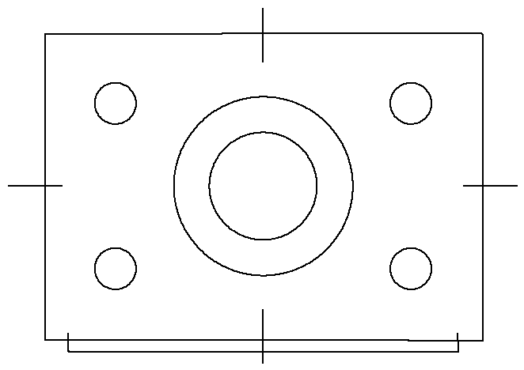

# img2cad — 图片一键描成 CAD 线稿（DXF）

把截图、扫描件、手绘稿、图标、照片自动矢量化，导出 **DXF**，
在 AutoCAD / 中望CAD / 浩辰CAD / CAXA 里打开就是可编辑的线条（整圆是真正的 `CIRCLE`）。



## 特性

- **零依赖**：PNG/BMP 解码、细化、DXF 写出全部自带，不需要 OpenCV、不需要 pip/npm 装包
- **三种用法**：单个 HTML 文件（浏览器）、网页版目录、命令行（Node ≥18）
- **两种识别**：线条中心线（工程图/线稿）／外轮廓（实心图案/照片），也能自动判断
- **真毫米**：`--width 420` 直接出 420mm 的图，不用在 CAD 里再缩放
- **圆会拟合成圆**：闭合轮廓自动识别成 `CIRCLE`，不是一堆折线
- **兼容性**：输出 DXF R12(AC1009)，老版本 CAD 也能开

## 快速开始

### 1. 浏览器（推荐，零安装）

打开 [`index.html`](index.html)（双击即可，或用 GitHub Pages 的在线地址），
把图片拖进去 → 左边出现蓝色描线预览 → 点「下载 DXF」。

> JPG / PNG / 截图都支持；全部在本机处理，不上传。

### 2. 命令行

```bash
node img2cad.mjs 图纸.png                  # 生成 图纸.dxf
node img2cad.mjs 图纸.png --width 420       # 图纸总宽 420mm，自动算比例
node img2cad.mjs 图纸.png --mode outline    # 强制按外轮廓
```

Windows 上可以把图片**直接拖到 `run.cmd` 图标上**。

## 参数

| 参数 | 作用 | 默认 |
|---|---|---|
| `-o, --out` | 输出 DXF 路径 | 与图片同名 `.dxf` |
| `--mode auto\|centerline\|outline` | 识别方式 | `auto` |
| `--invert` | 深底浅线（黑底白线） | 关 |
| `--threshold 0-255` | 手工二值化阈值 | Otsu 自动 |
| `--simplify 像素` | 简化容差，越大节点越少 | 1.5 |
| `--prune 像素` | 剪掉多短的毛刺 | 3 |
| `--min-len 像素` | 丢掉多短的碎线 | 6 |
| `--max-dim 像素` | 先缩到多大再算，控制速度 | 2000 |
| `--width 数值` | 图纸总宽（mm），算真实比例 | 不缩放 |
| `--scale 数值` | 1 像素 = 多少图形单位 | 1 |
| `--origin corner\|center` | 原点在左下角/图心 | corner |
| `--layer 名称` | 目标图层 | IMG |
| `--svg 文件` | 额外输出 SVG 预览 | — |
| `--json` | 只输出统计 JSON | — |

## 两种识别方式

- **centerline 中心线**（工程图、线稿、扫描图纸）：细化成单像素骨架再跟踪，
  得到线的中心线；整圆会拟合成 `CIRCLE`。
- **outline 外轮廓**（实心图案、图标、照片剪影）：沿色块边界描一圈，得到外轮廓 + 内孔。

`auto` 用「一次腐蚀后剩余比例」判断线条粗细、用「中间调占比」排除照片，自动二选一。

## 在 CAD 里使用

1. `OPEN` 打开 DXF，或把 DXF **拖进**当前图纸（作为块插入）；
2. 要 1:1 尺寸就生成时加 `--width 420`（网页版填「图幅宽」），出来即毫米；
3. `EXPLODE` 可把多段线炸开编辑；线宽/颜色改 `IMG` 图层即可。

## 调参经验

| 现象 | 怎么调 |
|---|---|
| 线条断续、毛刺多 | 降 `--max-dim 1600`，或 `--simplify 2`；扫描件先调对比度 |
| 节点太多、图很卡 | `--simplify 3`、`--min-len 12` |
| 圆变成多边形 | 调小 `--simplify 1.0`（正常会拟合圆） |
| 实心图案描成双重线 | 选 `--mode outline` |
| 线稿描成外框 | 选 `--mode centerline` |
| 白线黑底 | 加 `--invert` |
| 图形太小/太糊 | 先把图放大到 1500~2500px 宽 |

## 原理

```
灰度化 → Otsu 二值化 → 去噪点
        ├─ 中心线：Guo-Hall 细化 → 剪毛刺 → 方向连续性跟踪 → Douglas-Peucker 简化 → 圆拟合 → 端点桥接
        └─ 外轮廓：像素有向边 → 最右转闭环 → 简化
→ 坐标变换（翻转 Y、按 mm 缩放）→ DXF R12（POLYLINE / CIRCLE）
```

## 开发

```bash
npm run build   # 重新生成 web/src/core.js 和根目录 index.html（单文件版）
npm test        # 26 项断言：各种图/参数/边界情况
npm run demo    # 用 samples/flange.png 生成示例 DXF
```

> 改了 `src/` 一定要重新 `npm run build`，否则网页版用的还是旧算法。

## 目录

```
img2cad.mjs        命令行入口
index.html         单文件网页版（构建产物，可直接发给别人）
web/               网页版源码（index.html + app.js）
src/               算法与编解码
  png.mjs bmp.mjs  纯 JS 图片解码
  load.mjs         统一加载（JPG 借系统工具转换）
  vector.mjs       二值化、细化、骨架/轮廓追踪、简化、圆拟合
  dxf.mjs          DXF / SVG 写出
  pipeline.mjs     完整流水线（CLI 与网页共用）
test/              自测：造图、DXF 回读渲染、全量断言
build-core.mjs     打包 src → web/src/core.js
build-single.mjs   内联所有 JS → 根目录 index.html
samples/           示例图与示例 DXF
```

## 上传到 GitHub

这个仓库已经整理成可直接上传的结构（`.gitignore`、`LICENSE`、`package.json` 齐全）。

**方式 A：网页上传（不用装 git）**
1. GitHub 新建仓库 `img2cad`（不要勾选 README）；
2. Add file → Upload files，把整个文件夹拖进去（会包含子目录）；
3. Commit。

**方式 B：命令行**
```bash
git init
git add .
git commit -m "feat: img2cad 图片转 CAD 线稿"
git remote add origin https://github.com/<你的用户名>/img2cad.git
git push -u origin main
```

**发布在线版（GitHub Pages）**
Settings → Pages → Source 选 `Deploy from a branch` → Branch `main` / 目录 `/ (root)` → Save。
稍等片刻，`https://<你的用户名>.github.io/img2cad/` 就是网页版地址（根目录 `index.html` 是单文件版，打开即用）。

## 已知限制

- 虚线会连成实线（点划线识别不了）；
- 文字会被当成图形描成线条，需要文字请在 CAD 里重打；
- 圆弧输出为多段折线，只有整圆会变成 `CIRCLE`；
- 分辨率低于 300px 或严重模糊的图，效果明显下降。

## License

MIT
